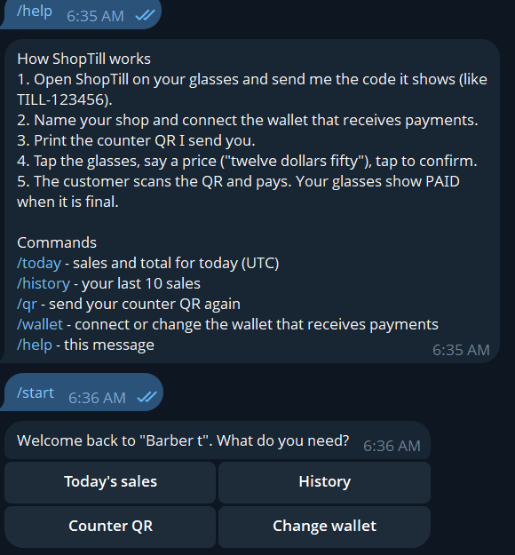
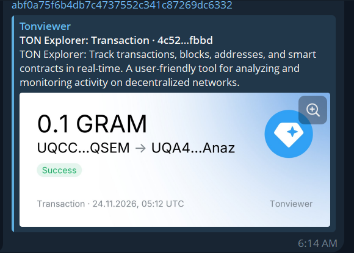
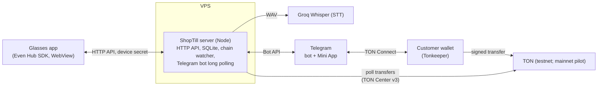

# ShopTill

**A silent till for Even G2 glasses: say the price, the customer pays in Telegram, and the glasses show PAID only when the TON chain finalizes it. Screenshots don't count.**

**[Telegram bot @ShopTillBot](https://t.me/ShopTillBot)** · **[Pay page](https://shoptill.103-195-188-198.sslip.io)** · [health check](https://shoptill.103-195-188-198.sslip.io/healthz) · **[First real payment (tonviewer)](https://testnet.tonviewer.com/transaction/060c5dce548948be0a171a0f6002f40ae40987ae4293b1e2b45cc9d56efcaefc)** · **[Mainnet payment (tonviewer)](https://tonviewer.com/transaction/4549066d17326fa1c0cd98a5a7abf0a75f6b4db7c4737552c341c87269dc6332)** · [Evidence](evidence/) · [Packaged app `shoptill.ehpk`](shoptill.ehpk) · [Demo script](DEMO_SCRIPT.md) · [Feature requests](FEATURE_REQUESTS.md)

ShopTill is for crypto-native sellers who take payments face to face, where the buyer already has a TON wallet. The lead case is the in-person P2P USDT trader: someone who swaps cash for USDT with a stranger and today checks tonviewer by hand. The glasses show PAID only after the chain finalizes the payment, and they flag look-alike (fake) tokens that a hand check or a naive watcher can miss. The seller keeps their eyes on the person and the goods, not on a phone. ShopTill never holds money or keys.

> *"They say they paid. Is it real, or is that a screenshot?"*

Heads Up: Even Realities hackathon (DoraHacks). Tracks: **Crypto & DeFi** (TON chain, TON Connect), **Messaging** (Telegram bot and Mini App) and **Best Telegram integration**. The demo runs on **TON testnet**. The same build also took **one real mainnet payment** (0.10 GRAM, [evidence](evidence/mainnet-pilot.md)); it went between the owner's own wallets, and a setup bug it exposed (the receiving wallet had to be a testnet account) is fixed.

**What is real and what is not, at a glance**

| | Status |
|---|---|
| TON chain reads, payment classification, fake-token detection | Real, on testnet (live harness 8/8, P0 11/11) |
| Real-money payment | One, 0.10 GRAM on mainnet. Mainnet USDT not yet paid |
| Telegram bot, Mini App, TON Connect, receipts | Real and live ([@ShopTillBot](https://t.me/ShopTillBot)) |
| Voice price | Real PC microphone through the simulator (Groq Whisper) |
| Glasses | Even Hub **simulator** only. Not yet run on physical G2 hardware |
| Detection time, block to PAID | 2 to 5.5 s across 4 logged payments ([raw log](evidence/server-log.txt)) |
| Customer wallet | Tonkeeper (testnet and mainnet). Wallet in Telegram not yet tested |

## What it looks like

Real 576x288 glasses captures from the Even Hub simulator against the live testnet server, unless the caption says otherwise.

| | | |
|:--:|:--:|:--:|
| <br>Pairing code to send to the bot | <br>"Say a price" | <br>Preset picker (swipe, no voice needed) |
| <br>READY 12.00 USDT, waiting | <br>FAKE: a real look-alike jetton sent on testnet, NOT PAID, still waiting | <br>PAID: the honest payment that followed on the same sale, no taps ([tx](https://testnet.tonviewer.com/transaction/a58b9325f62d44dcabba9371ff43065204942a496dfdcfd6a5e8061992bde0ea)) |
| <br>SHORT 5.00 of 10.00, waiting for the rest (live testnet) | <br>Payment seen, confirming (earlier capture) | <br>PAID 12.50 USDT from the owner's real voice run (UAT 2) |
| <br>PAID 0.10 GRAM on mainnet (pilot) | <br>The bot's /help and the seller button menu (Telegram Desktop) | <br>Receipt in Telegram with the mainnet tonviewer card |

## Why this exists

Fake "payment successful" screenshots are a named fraud for offline vendors. The usual advice is to check the account instead, which means looking down at a phone or explorer while the other person stands in front of you. For a P2P USDT trader that check is a manual tonviewer lookup in the middle of a trade.

On TON there is a worse trap: scammers airdrop fake look-alike USDT jettons. A quick glance or a naive watcher that sees "1 USDT arrived" shows PAID for a worthless token. ShopTill checks the token master against an allowlist and shows FAKE TOKEN, NOT PAID.

What exists today, and where it stops: a payment-confirmation soundbox (the Paytm kind) announces a bank callback aloud, needs dedicated hardware, and tells the whole shop what you charged. A block explorer is correct but needs you to look down and know what to check. Neither flags a look-alike token for you. G2 has no speaker, so ShopTill is the silent version that only the seller can see.

```
 customer shows a screenshot                 ShopTill ignores it
        |                                           |
        v                                           v
   "I paid!"  ------ nothing on chain ------>  glasses: READY 12.00 USDT, waiting

 customer pays in Telegram (TON Connect) ---> real tx finalized ---> PAID 12.00 USDT
 attacker sends look-alike USDT, right ref -> not on the allowlist -> FAKE, NOT PAID, still waiting
 ...then the customer pays for real ---------> same sale ----------> PAID (no taps)
```

## What it does

1. **Pairs.** The glasses show a code like `TILL-482193`. The seller sends it to @ShopTillBot, names the shop and connects a receiving wallet with TON Connect. The bot returns a counter QR to print. Output: a paired till and a QR.
2. **Takes a price.** The seller says "twelve dollars fifty" or swipes through presets (5, 10, 12, 20, 50). A confirm screen shows what was heard and nothing starts until the seller taps. Output: `READY 12.50 USDT`, a sale with its own reference. Speech goes through Groq Whisper; the number parser itself is deterministic code, no LLM.
3. **Lets the customer pay.** They scan the QR and the Mini App opens in Telegram ("Pay <shop>", with amount and asset). They connect a wallet, sign, and the transfer goes from their wallet straight to the seller's. A SHORT sale's pay page asks only for the missing amount. Setup and pay pages refuse a wallet on a different network than the server.
4. **Lets the chain decide.** The server reads TON Center for transfers to the seller and checks success, token allowlist, per-sale reference, amount and time window. Only a finalized match flips the glasses to `PAID`. A matching payment that is seen but not final shows as confirming (GRAM). Output: PAID, or one of SHORT, EXTRA, DUPLICATE, FAKE, UNMATCHED, LATE.
5. **Reports.** Tap for a receipt in the customer's Telegram, with a tonviewer link anyone can open. Double tap voids an unpaid sale. Swipe down shows today's total. The same classifier runs for every state, and failed or bounced transactions are never counted.

If the server cannot read the chain for more than 15 s, the glasses say "chain check delayed" instead of staying quiet. Sellers can also use `/today`, `/history` and `/wallet` in the bot.

## Quickstart

You need no hardware. The glasses app runs in the Even Hub simulator against my live server.

```bash
# 1. Install (Node 22)
git clone https://github.com/Techkeyy/shoptill && cd shoptill
npm install

# 2. Configure: point the glasses app at the live server
export VITE_API_BASE=https://shoptill.103-195-188-198.sslip.io   # PowerShell: $env:VITE_API_BASE="..."

# 3. Run: glasses app, then the simulator in a second terminal
cd apps/glasses && npm run dev
npm run simulate
```

Health check first: `curl -s https://shoptill.103-195-188-198.sslip.io/healthz`.

1. The simulator shows a pairing code (`TILL-xxxxxx`). Send it to [@ShopTillBot](https://t.me/ShopTillBot), name the shop and connect a TON testnet wallet with the button the bot sends.
2. Swipe to a preset and tap to arm it (`READY 12.00 USDT`).
3. Open the counter link from the bot in a second Telegram account and pay from a testnet wallet that holds test USDT and a little test GRAM (GRAM faucet: @testgiver_ton_bot). The demo USDT is a test jetton I minted on testnet (master `kQDT4p…EXT`), which no public faucet provides. Real runs are in [evidence/](evidence/), or ask in the hackathon chat for a funded test wallet. You can mint your own with the scripts below.
4. Watch the simulator flip to `PAID`, then tap to send the receipt.

Offline path, no payment needed: arm a sale and show a screenshot of anything. The glasses stay `READY`. Or run the tests (below), which need no network.

### Run your own server

Prerequisites: a Telegram bot token from @BotFather, a Groq API key, and optionally a TON Center API key (raises the rate limit).

```bash
npm run build -w shoptill-pay          # Mini App; also needed before the server tests on a fresh clone
npm run build -w @shoptill/server
cp server/.env.example server/.env     # fill in, then export or load it
node server/dist/server.mjs
```

Environment variables (names only, see `server/.env.example` and `server/src/config.ts`):

| Variable | Meaning |
|---|---|
| `TELEGRAM_BOT_TOKEN`, `GROQ_API_KEY` | Bot and speech to text |
| `TONCENTER_API_KEY` | Optional. Without it TON Center rate limits to about 1 request per second |
| `PUBLIC_URL`, `PORT` | Public origin (used in links) and listen port, default 8799 |
| `NETWORK` | `testnet` unless set to `mainnet` |
| `DB_PATH` | SQLite file. Use an absolute path in production |
| `JETTON_CONFIG` | Path to the jetton allowlist JSON (`packages/core/testnet.config.json` by default, `packages/core/mainnet.config.json` for mainnet) |
| `PAY_DIR` | Directory of the built Mini App (defaults to `apps/pay/dist`) |

| Part | Commands |
|---|---|
| Glasses app | `cd apps/glasses && npm run dev` (Vite on :5173), `npm run simulate`, `npm run build`, `npm run pack` |
| Point glasses at a server | Set `VITE_API_BASE=https://your-server`. The app falls back to `http://localhost:8787` only for local dev. |
| Deploy to a VPS | `server/deploy/deploy.sh` (esbuild bundle, scp, systemd restart; unit and Caddy snippet are in `server/deploy/`) |
| Switch network | `server/deploy/network.sh mainnet` or `testnet` edits `NETWORK`, `DB_PATH` and `JETTON_CONFIG` on the VPS and restarts. Each network has its own database. |

`npm run pack` in `apps/glasses` runs `evenhub pack app.json dist` and writes `out.ehpk`. `shoptill.ehpk` at the repo root is that file, built with `VITE_API_BASE=https://shoptill.103-195-188-198.sslip.io`. The `app.json` network whitelist allows only that origin.

### Tests

Counted on 2026-11-24: server 106, glasses 51, core 29, **186 in total**.

```bash
npm run build -w shoptill-pay       # first, on a fresh clone: server/src/static.test.ts needs apps/pay/dist
npm test -w @shoptill/server        # 106 tests
npm test -w shoptill-glasses        # 51 tests
npm test -w @shoptill/core          # 29 tests (24 match, 5 toncenter)
```

### Testnet dev tools (`packages/core/scripts`)

They send real testnet transactions and read two throwaway wallets and two test jettons from a gitignored `.secrets/` folder (`testnet-wallets.json`, `testnet-jettons.json`). Run them from the repo root with `npx tsx`.

| Script | Job | Writes |
|---|---|---|
| `wallets.ts` (`npm run spike:wallets -w @shoptill/core`) | Creates the merchant and customer test wallets | `.secrets/testnet-wallets.json` |
| `jettons.ts` (`npm run spike:jettons -w @shoptill/core`) | Deploys the allowlisted and the look-alike test jettons | `.secrets/testnet-jettons.json` |
| `topup.ts` | Moves test GRAM between the two test wallets | none |
| `pay.ts` (`npm run spike:pay -w @shoptill/core`) | P0 spike: 11 payments classified by the real client | `evidence/p0-spike.md` |
| `demo-send.ts` | Sends a staged payment: `--to <seller> --amount 12 --token fake\|usdt\|gram [--ref <ref>] [--no-comment]` (testnet only) | none |
| `real-input.ts` | Read-only replay on real mainnet payments, no keys | `evidence/real-input.md` |

The live edge states harness is `npx tsx server/scripts/live-states.ts` (writes `evidence/live-states.md`).

## Architecture



| Module | Job |
|---|---|
| `packages/core/src/match.ts` | Pure payment classifier: success, allowlist, ref, amount, time window |
| `packages/core/src/toncenter.ts` | TON Center v3 client with paginated reads, normalises native and jetton transfers |
| `server/src/service.ts` | Till logic: pairing, sales, sub-refs, watcher loop, receipts |
| `server/src/api.ts` | HTTP routes for glasses and pay page, static files, rate limits |
| `server/src/bot.ts` | Telegram bot: pairing, shop setup, /today, /history, /wallet, receipts |
| `server/src/amount.ts` | Deterministic spoken-number to decimal parser (no LLM) |
| `apps/glasses/src` | G2 app: screens, gestures, polling, WAV recorder |
| `apps/pay/src` | Telegram Mini App: TON Connect, wallet and network guards, pay button |

The glasses API is documented in [apps/glasses/API.md](apps/glasses/API.md). Order of checks in the classifier: finalized and successful, then allowlisted token, then reference matches an open sale, then amount, then time window. State is recomputed from stored chain payments on every tick and no endpoint writes it, so no API call can set PAID.

## Why the fake-token angle matters

Most "did they pay" tools watch for an incoming amount. On TON, anyone can send you a jetton named USDT for the price of the gas, with the right comment and the right amount, because a sale's reference is shown to the customer. The only difference from the real thing is the jetton master address. ShopTill compares that master to an allowlist before anything can become PAID. Concrete proof: on testnet a look-alike jetton with a valid reference was sent to a live sale, the glasses showed FAKE and stayed waiting ([screen](evidence/screens/fake.png)), then the honest payment on the same sale flipped them to PAID with no taps ([screen](evidence/screens/paid.png), [tx](https://testnet.tonviewer.com/transaction/a58b9325f62d44dcabba9371ff43065204942a496dfdcfd6a5e8061992bde0ea)).

## How I tried to break it

| Attack or failure | Result | Evidence |
|---|---|---|
| Customer shows a payment screenshot | Glasses stay READY. No endpoint can write PAID. | Security audit Q2; shown in [DEMO_SCRIPT.md](DEMO_SCRIPT.md) |
| Look-alike USDT with a valid reference | FAKE, NOT PAID, sale stays open; a later honest payment shows PAID | [live-states](evidence/live-states.md) row 5, [p0-spike](evidence/p0-spike.md) row 11, [fake.png](evidence/screens/fake.png) |
| Pay less, more, twice, or after a void | SHORT (stays open, top-up completes it), EXTRA, DUPLICATE, LATE | [live-states](evidence/live-states.md) rows 2, 3, 4, 7 |
| Payment with no comment | UNMATCHED; tap to attach to the open sale | [live-states](evidence/live-states.md) row 6 |
| Credit to a never-used wallet, reported `aborted: true` by TON Center | Money still counts (mainnet pilot paid this way) | [mainnet-pilot](evidence/mainnet-pilot.md) |
| Seller's own wallet pays itself | Pay page blocks it; glasses stayed READY | [UAT 1](evidence/uat-1-first-payment.md) |
| Wallet on the wrong network | Setup and pay pages refuse it (`GET /api/network`) | [mainnet-pilot](evidence/mainnet-pilot.md), server tests |
| Voice mishears the price (250, 50, "0.1" without gram) | The confirm screen caught each; nothing was charged | [UAT 2](evidence/uat-2-repair-voice-pay.md), [mainnet-pilot](evidence/mainnet-pilot.md) |
| Stolen `deviceId`, pairing-code brute force, request abort crash | Fixed: 192-bit device secret, 6-digit 30 min codes with lockouts, guarded handler; 15 regression tests | [security-audit](evidence/security-audit.md) |
| Server cannot read the chain for 15 s | Glasses show "chain check delayed" and `chainDelayed` in the status API | server and glasses unit tests |
| 2,815 real mainnet payments to two busy wallets, read-only | Nothing counted, no false FAKE. Tests false positives, not detection (no sale reference was present). | [real-input](evidence/real-input.md) |
| Known blind spot: malicious jetton wallet that falsely claims a genuine master | Not caught (disclosed D-2; needs an on-chain `get_wallet_address` check) | [security-audit](evidence/security-audit.md) |

**Key invariant: a screenshot, a bounced transaction, a non-allowlisted token or a payment without the sale's reference never produces PAID.** Rules decide the state deterministically; the only model in the loop is Whisper, and a human taps to confirm what it heard.

### Proof

| Evidence | What it shows | Result |
|---|---|---|
| [Mainnet pilot](evidence/mainnet-pilot.md) | One real 0.10 GRAM payment: voice price, paid from a Tonkeeper mainnet wallet, PAID 5.5 s after the block ([raw log](evidence/server-log.txt)), receipt sent. [tonviewer](https://tonviewer.com/transaction/4549066d17326fa1c0cd98a5a7abf0a75f6b4db7c4737552c341c87269dc6332) | One real payment, end to end |
| [UAT 2](evidence/uat-2-repair-voice-pay.md) | Re-pair, spoken "Twelve dollars fifty." heard as 12.50 USDT, paid, PAID about 2 s after the block, receipt | PASS |
| [UAT 1](evidence/uat-1-first-payment.md) | Owner paid 12 test USDT from Tonkeeper testnet through the Mini App; PAID and a Telegram receipt. [tx](https://testnet.tonviewer.com/transaction/060c5dce548948be0a171a0f6002f40ae40987ae4293b1e2b45cc9d56efcaefc) | PASS |
| [Live edge states](evidence/live-states.md) | The real server service against real testnet, 8 cases, each with a transaction link | **8/8** |
| [P0 spike](evidence/p0-spike.md) | 5 native GRAM, 5 allowlisted USDT, 1 look-alike USDT on testnet | **11/11** classified correctly; detection 1.3 to 3.6 s from send acceptance |
| [Real-input replay](evidence/real-input.md) | 2,815 real mainnet payments, read-only | Nothing falsely counted |
| [Security audit](evidence/security-audit.md) | Three high findings found, fixed and covered by tests; limitations disclosed | See Limits |

Latency, measured server-side from block time to PAID: 2 s (UAT 2), 3.6 s and 4.1 s (testnet screenshot runs) and 5.5 s (mainnet pilot), all without a TON Center API key. The raw log lines are in [evidence/server-log.txt](evidence/server-log.txt). The live-states harness took 12 to 25 s, but that includes a wait of about 10 s for the wallet sequence number plus request throttling, so it is not user-perceived latency.

**Live edge states (8/8):**

| Case | Observed | Transaction |
|---|---|---|
| PAID, exact 1.00 USDT | PAID | [14cc2273](https://testnet.tonviewer.com/transaction/14cc22735119d0be0266a76ba1e516ce651a8f7a022952a4337bf1ecc11534a5) |
| SHORT 0.40, then top-up 0.60 | SHORT, then PAID | [bdac07dd](https://testnet.tonviewer.com/transaction/bdac07dd5055ec0ba6cc51e1bb37ba7318dbb06cc4601baf2d69e471a0262758), [832f8d2c](https://testnet.tonviewer.com/transaction/832f8d2cdbe34b41a26952abd31cef2ec17c4194f9658a58e4a908123613d83b) |
| EXTRA, 1.30 for 1.00 | EXTRA | [1d72dcf8](https://testnet.tonviewer.com/transaction/1d72dcf8fdb7fa2ac010ae61450362b70bdaaae897cce48801df94ba2a5e5db0) |
| DUPLICATE, two full payments | DUPLICATE | [83f521e9](https://testnet.tonviewer.com/transaction/83f521e98c1a097a2c44e6feac5c207221660b27e3ed6c294a8685da8cb35b30), [4bbc4804](https://testnet.tonviewer.com/transaction/4bbc4804e644d194211cdfb431327d490934e196d727e91a357fcf0dfb06a909) |
| FAKE, look-alike USDT with a valid ref | FAKE | [f6d75e2a](https://testnet.tonviewer.com/transaction/f6d75e2a8150d5fd7f26b42781d845646ae7b68740643aa3f767f761362038d1) |
| UNMATCHED (no comment), then attach | UNMATCHED, then PAID | [ec1bc77d](https://testnet.tonviewer.com/transaction/ec1bc77d3179ad0f7ecaf4c8f3cc3e444ee154e6812b4582096b6e5e120ef40d) |
| LATE, pay a voided sale | LATE | [9f0610ac](https://testnet.tonviewer.com/transaction/9f0610ac1578b31a2785db11df60978100176470b623b0a2131cb5c332dd60d6) |
| GRAM sale, 0.05 GRAM | PAID | [cdb902d8](https://testnet.tonviewer.com/transaction/cdb902d8d510379d27fe002c0e863bc266cdc0f1951bef0b9f4b5049b8f76080) |

**Real-chain lessons: what naive watchers get wrong.** The P0 spike hit three behaviours that a watcher written from the docs gets wrong. All three are handled in the code:

1. **A credited payment to a never-used (uninitialised) wallet is reported `aborted: true`** (compute skipped, `no_state`), even though the money arrived. ShopTill ignores `aborted` and counts money as arrived only if `credit_ph.credit > 0` and there is no `ok` bounce phase.
2. **A bounceable transfer to a fresh wallet bounces back.** The pay page sends GRAM non-bounceable.
3. **Attaching only 0.05 TON to a jetton transfer fails with exit 709** (not enough TON). We attach 0.1 TON and keep jetton sends bounceable so a failure refunds the customer.

**Fixed after the first audits (2026-11-23 and 2026-11-24), as shipped:**

- CONFIRMING is wired in production. The chain wrapper had dropped `includePending`, so the state existed in tests but never appeared live.
- The glasses keep polling on FAKE and UNMATCHED, so an honest payment after a fake still shows PAID.
- A SHORT sale's pay page asks only for the missing amount.
- Setup and pay pages require the wallet network to match the server.
- STT has a per-IP limit (30 per minute) and a 20 s timeout.
- `/today` counts DUPLICATE money.
- Security audit highs: device secret, pairing lockout, remote crash (deployed 2026-11-23). 15 security regression tests cover them.

## Safety

- **ShopTill never holds keys or funds.** The customer signs in their own wallet and the transfer goes straight to the seller. The server stores only the seller's public address. The product code contains no mnemonic or private key (audit grep of `server/src`, `apps/*`, `packages/core/src`).
- **Testnet demo, one mainnet pilot.** One mainnet payment (0.10 GRAM, the owner's own funds) was run with `server/deploy/network.sh mainnet` and its own database, then switched back. Mainnet USDT is allowlisted in `packages/core/mainnet.config.json` but has not been paid yet.
- **Device secret.** Each pair of glasses holds a random secret and sends it on every call. Unknown and wrong secrets get the same 403.
- **No secrets in the repo or its git history** (audit grep of history; `.env*` and `.secrets/` are gitignored).
- **Disclosed, not fixed** (full list D-1 to D-8 in the audit):
  - Anyone can send dust, or a payment with no comment, to a seller's public address and the glasses show UNMATCHED. It cannot cause PAID.
  - FAKE protection trusts the jetton master that TON Center reports. A malicious jetton wallet that falsely claims a genuine master would not be caught.
  - The Telegram shop link uses sequential ids, so shop names are enumerable.
  - CORS is `*` and the Mini App has no CSP. There are no cookies; auth is by header or signed token.
- **Real-input gaps** (`evidence/real-input.md`): during an open sale every unrelated incoming transfer shows as UNMATCHED, by design. The replay saw 4 non-allowlisted jetton masters, a thin spam sample. Both wallets hit the 1,000-row jetton cap (10 pages of 100), so their 24 h window is incomplete. PAID was not possible (no sale reference was present), so it tests noise, not detection.
- **Gram Wallet is not in the demo.** Telegram's Gram Wallet supports TON Connect on mainnet only, so the testnet demo uses Tonkeeper testnet. The mainnet pilot paid from Tonkeeper; Gram Wallet (Wallet in Telegram) itself is untested.
- **G2 cannot alert while the app is closed.** The bot is meant to DM the seller then. That DM path is implemented but not yet tested on a closed-glasses run.

## Business

- **Target user:** crypto-native sellers who take payments face to face and whose buyers already hold TON: in-person P2P USDT traders first, then booths and bars at TON and crypto events, and Telegram sellers who hand over goods in person.
- **Proof that people pay to be told "you were paid" (public reporting, not verified by me):** merchants pay monthly for soundboxes (Paytm Soundbox, about Rs 125 to 150 a month per a 2023 BofA study, from my research notes). Those merchants are not the target customer. Fake screenshots are a named fraud in the payment-provider guides I read.
- **Versus a soundbox:** silent and private (only the seller sees it), reads the chain instead of a bank callback, and flags look-alike tokens. A soundbox needs dedicated hardware; ShopTill needs glasses the seller already wears.
- **Pricing (PLANNED, untested):** free for sellers. Revenue would come from the bundle or partner deal under Limits and trust. Nobody has paid for it.
- **TON Pay (PLANNED):** TON Pay is a checkout for online merchants. ShopTill is the counter-side confirmation for face-to-face sales, so I see them as complementary. No TON Pay integration exists.
- **TVM PayFi fit (PLANNED):** positioning only; there has been no contact with TVM.
- **Other surfaces (PLANNED):** the server is a payment-truth service, so a phone widget or a physical soundbox could use the same API. Only the G2 app is built.

## Limits and trust

- **Till mode, not always-on.** G2 shows one app at a time, and Even Hub has no way to alert the wearer while the app is closed (see [FEATURE_REQUESTS.md](FEATURE_REQUESTS.md) item 1). So the seller opens ShopTill per sale, like a card terminal, from saying the price until PAID. Payments that arrive after they switch away reach their phone instead (bot DM, `/today`) and show as LATE or UNMATCHED.
- **Who you trust.** The seller no longer trusts a screenshot. They trust the ShopTill server to read the chain. Mitigations:
  - If the server is unreachable, the glasses say "Offline", never silence.
  - If the server cannot read the chain for more than about 15 seconds, the glasses show "Chain check delayed - do not hand over yet".
  - Every receipt carries a tonviewer link that anyone can check.
  - ShopTill never holds money or keys.
  - The code is MIT, so anyone can run their own server (see [Run your own server](#run-your-own-server)).
- **The buyer must already use crypto.** ShopTill does not onboard new crypto users.
- **Business path (a plan, not done).** Without custody there is no per-payment fee to skim, and a monthly fee like a soundbox does not fit a glasses app. The realistic path is a bundle with Even Realities or a TON merchant or payments partner. No such deal exists.

## Known limitations

- **Simulator, not hardware.** Everything ran in the Even Hub simulator. I have not run it on physical G2 glasses. Glyphs are plain ASCII (`(!)`, `|`) because the supported glyph set is not documented.
- **Runs on one VPS as root.** The service has `NoNewPrivileges` and `PrivateTmp`; a dedicated user is left for later.
- **Pairing.** It is trust on first use, and the global pairing lockout can be tripped by an attacker to block new pairings (denial of service).
- **One receiving address per shop.** Two shops sharing one receiving address would conflict.
- **TON Center without an API key.** It is rate limited, which likely adds to the 2 to 5.5 s detection time. I have not measured with a key.
- **Mainnet is thin.** One payment (GRAM, from Tonkeeper). Mainnet USDT and Gram Wallet are untested.
- **Voice.** Tried through the simulator microphone in UAT 2 ("Twelve dollars fifty." gave 12.50 USDT) and the mainnet pilot ("zero point one gram." gave 0.10 GRAM). Misheard first tries happened (250, 50, and "0.1" without "gram"); the confirm screen caught them, and a word between the numbers ("dollars") makes recognition much more reliable.
- **Untested live:** `/history` and the seller DM with the glasses closed. `/today` counts are unit-tested.
- **No refunds.** ShopTill is non-custodial, so over-payments and duplicates are refunded by the seller from their own wallet.
- **Open polish from UAT 1:** the receipt screen's second line and the first swipes after pairing have code fixes with unit tests but were not re-verified in a live session.

## What existed before Nov 23

Nothing. The repo was created on 2026-11-23, the first day of the build window. The glasses app started from the official [even-realities/evenhub-templates `asr` template](https://github.com/even-realities/evenhub-templates/tree/main/asr). `apps/glasses/ORIGIN.md` lists what was kept (Vite and TypeScript setup, the container and event-handling pattern); everything else was written for ShopTill.

Open-source libraries and services used: Even Hub SDK `@evenrealities/even_hub_sdk` 0.0.16, `@evenrealities/evenhub-cli`, `@evenrealities/evenhub-simulator`, Vite, TypeScript, Vitest, `@ton/core`, `@ton/ton`, `@ton/crypto`, `@ton-community/assets-sdk` (test jetton minting), `@tonconnect/ui`, `buffer`, `qrcode`, esbuild. External services: TON Center v3, Telegram Bot API, Groq Whisper API.

What I asked the platforms for while building is in [FEATURE_REQUESTS.md](FEATURE_REQUESTS.md): a wearer notification while the app is closed, on-device or keyless STT, a glyph reference for the 576x288 display, a Gram Wallet testnet and payment link with a reference, and a verified flag on TON Center jetton transfers. I did not file public issues for these.

## License

[MIT](LICENSE), Techkeyy.
