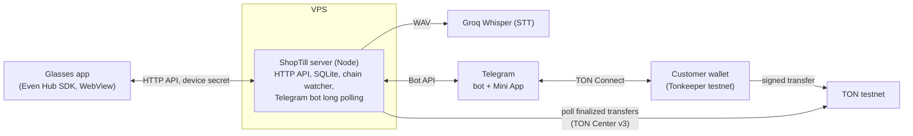

# ShopTill

**Say the price, your customer pays in Telegram, and your glasses show PAID only when the TON chain confirms it. Screenshots don't count.**

**[Telegram bot @ShopTillBot](https://t.me/ShopTillBot)** · **[Pay page](https://shoptill.103-195-188-198.sslip.io)** · [health check](https://shoptill.103-195-188-198.sslip.io/healthz) · **[First real payment (tonviewer)](https://testnet.tonviewer.com/transaction/060c5dce548948be0a171a0f6002f40ae40987ae4293b1e2b45cc9d56efcaefc)** · **[Mainnet payment (tonviewer)](https://tonviewer.com/transaction/4549066d17326fa1c0cd98a5a7abf0a75f6b4db7c4737552c341c87269dc6332)** · [Evidence](evidence/) · [Packaged app `shoptill.ehpk`](shoptill.ehpk) · [Feature requests](FEATURE_REQUESTS.md) · [Demo script](DEMO_SCRIPT.md)

ShopTill is a silent soundbox for Even G2 glasses. It is for people who take payments face to face with busy hands: barbers, coffee stands, pop-up sellers, tattoo artists, trainers.

> *"They say they paid. Is it real, or is that a screenshot?"*

Heads Up: Even Realities hackathon. Tracks: **Crypto & DeFi** (main; TON chain and TON Connect), **Messaging** (Telegram bot + Mini App), and **Best Telegram integration**. The demo runs on **TON testnet**. The same build also took **one real mainnet payment** (0.1 GRAM, [evidence](evidence/mainnet-pilot.md)): voice price, Tonkeeper pay, PAID on the glasses, finalized on chain.

## Why this exists

Fake "payment successful" screenshots are a named fraud for offline vendors. The usual advice is to check the account instead, which means stopping work and taking out the phone. In India, merchants already pay a monthly fee for a soundbox that announces each payment aloud (about Rs 125 to 150 a month per a 2023 BofA study, as cited in my research notes). They pay just to be told "you were paid", and that proves the habit.

On TON there is an extra trap: scammers airdrop fake USDT jettons, and a naive watcher that sees "1 USDT arrived" shows PAID for a worthless token.

```
 customer shows a screenshot                 ShopTill ignores it
        |                                           |
        v                                           v
   "I paid!"  ------ nothing on chain ------>  glasses: READY 12.00 USDT, waiting

 customer pays in Telegram (TON Connect) ---> real tx confirmed ---> PAID 12.00 USDT
 attacker sends look-alike USDT, right ref -> not on the allowlist -> FAKE TOKEN, NOT PAID
```

G2 has no speaker, so this is a silent soundbox that only the seller can see. The whole shop does not hear how much you charged.

## How it works

1. **Pair.** The glasses show a code like `TILL-482193`. The seller sends it to @ShopTillBot, names the shop and connects a receiving wallet with TON Connect. The bot returns a counter QR to print.
2. **Say a price.** "Twelve" arms the till: `READY 12.00 USDT`. Swipe steps through presets (5, 10, 12, 20, 50) if voice is not an option.
3. **Customer pays.** They scan the QR, the Mini App opens in Telegram ("Pay 12.00 to the shop"), they connect a wallet and sign. The money goes from their wallet straight to the seller's.
4. **Chain decides.** The server watches TON Center for finalized transfers to the seller, checks success, token allowlist, per-sale reference, amount and time window, and only then flips the glasses to `PAID`.
5. **Tap for a receipt.** The customer gets a receipt in Telegram with a tonviewer link. Double tap voids an unpaid sale. Swipe down shows today's total.

Other states, all produced by the same classifier: `SHORT` (partial, stays open), `EXTRA`, `DUPLICATE`, `FAKE TOKEN`, `UNMATCHED` (tap to attach to the open sale), `LATE` (paid after void or expiry). Failed or bounced transactions are never counted.

## Proof

Strongest artifacts first. Everything is testnet except the read-only mainnet replay and the one-payment mainnet pilot.

| Evidence | What it shows | Result |
|---|---|---|
| [Mainnet pilot](evidence/mainnet-pilot.md) | One real 0.1 GRAM payment: voice price on the glasses, customer paid from a Tonkeeper mainnet wallet, glasses showed PAID 5.5 s after the block, receipt sent. Finalized on chain: [tonviewer](https://tonviewer.com/transaction/4549066d17326fa1c0cd98a5a7abf0a75f6b4db7c4737552c341c87269dc6332). | One real payment, end to end |
| [UAT 1: real owner payment](evidence/uat-1-first-payment.md) | The owner paid 12 test USDT from Tonkeeper testnet through the Telegram Mini App. The glasses (simulator) showed PAID and a receipt reached Telegram. [Transaction](https://testnet.tonviewer.com/transaction/060c5dce548948be0a171a0f6002f40ae40987ae4293b1e2b45cc9d56efcaefc) | PASS |
| [Live edge states](evidence/live-states.md) | The real server service against real testnet, 8 cases, each with a transaction link | **8/8** |
| [P0 spike](evidence/p0-spike.md) | 5 native GRAM, 5 allowlisted USDT, 1 look-alike USDT sent on testnet | **11/11** classified correctly; detection 1.3 to 3.6 s from send acceptance |
| [Real-input replay](evidence/real-input.md) | On 2,815 real mainnet payments (2 busy wallets, read-only), the checker never counted a payment without our reference, never counted a non-allowlisted token, and the run completed without error. PAID was not possible here because no sale reference was present, so this tests false positives from real-world noise, not detection. The busiest wallet hit the 10-page cap, so its window is incomplete. | Nothing falsely counted |
| [Security audit](evidence/security-audit.md) | Three high findings (device auth, pairing-code brute force, remote crash) found, fixed and covered by tests; 8 limitations disclosed | See summary below |

**Live edge states (8/8):**

| Case | Observed | Transaction |
|---|---|---|
| PAID, exact 1.00 USDT | PAID | [14cc2273](https://testnet.tonviewer.com/transaction/14cc22735119d0be0266a76ba1e516ce651a8f7a022952a4337bf1ecc11534a5) |
| SHORT 0.40, then top-up 0.60 | SHORT, then PAID | [bdac07dd](https://testnet.tonviewer.com/transaction/bdac07dd5055ec0ba6cc51e1bb37ba7318dbb06cc4601baf2d69e471a0262758), [832f8d2c](https://testnet.tonviewer.com/transaction/832f8d2cdbe34b41a26952abd31cef2ec17c4194f9658a58e4a908123613d83b) |
| EXTRA, 1.30 for 1.00 | EXTRA | [1d72dcf8](https://testnet.tonviewer.com/transaction/1d72dcf8fdb7fa2ac010ae61450362b70bdaaae897cce48801df94ba2a5e5db0) |
| DUPLICATE, two full payments | DUPLICATE | [83f521e9](https://testnet.tonviewer.com/transaction/83f521e98c1a097a2c44e6feac5c207221660b27e3ed6c294a8685da8cb35b30), [4bbc4804](https://testnet.tonviewer.com/transaction/4bbc4804e644d194211cdfb431327d490934e196d727e91a357fcf0dfb06a909) |
| FAKE, look-alike USDT with a valid ref | FAKE | [f6d75e2a](https://testnet.tonviewer.com/transaction/f6d75e2a8150d5fd7f26b42781d845646ae7b68740643aa3f767f761362038d1) |
| UNMATCHED (no comment), then attach | UNMATCHED, then PAID | [ec1bc77d](https://testnet.tonviewer.com/transaction/ec1bc77d3179ad0f7ecaf4c8f3cc3e444ee154e6812b4582096b6e5e120ef40d) |
| LATE, pay a voided sale | LATE | [9f0610ac](https://testnet.tonviewer.com/transaction/9f0610ac1578b31a2785db11df60978100176470b623b0a2131cb5c332dd60d6) |
| GRAM sale, 0.05 GRAM | PAID | [cdb902d8](https://testnet.tonviewer.com/transaction/cdb902d8d510379d27fe002c0e863bc266cdc0f1951bef0b9f4b5049b8f76080) |

**Real-chain lessons: what naive watchers get wrong.** The P0 spike hit three behaviours that a watcher written from the docs gets wrong. All three are handled in the code:

1. **A credited payment to a never-used (uninitialised) wallet is reported `aborted: true`** (compute skipped, `no_state`), even though the money arrived. ShopTill ignores `aborted` and counts money as arrived only if `credit_ph.credit > 0` and there is no `ok` bounce phase.
2. **A bounceable transfer to a fresh wallet bounces back.** The pay page now sends GRAM non-bounceable.
3. **Attaching only 0.05 TON to a jetton transfer fails with exit 709** (not enough TON). We attach 0.1 TON and keep jetton sends bounceable so a failure refunds the customer.

**Security audit summary.** The 2026-11-23 audit found no path to PAID without real money. It found and fixed: control of a till by anyone who learned the `deviceId` (now a 192-bit device secret, only its SHA-256 stored), pairing-code hijack by brute force (6 digits, 30 min expiry, per-chat and global lockout), and a remote crash from an aborted request. 15 security regression tests cover the fixes. See [Safety](#safety) for what is left. The fixes were deployed on 2026-11-23 (server restarted, device secret enforced). The audit file has a deployment status section and lists what was not verified.

## Architecture



| Module | Job |
|---|---|
| `packages/core/src/match.ts` | Pure payment classifier: success, allowlist, ref, amount, time window |
| `packages/core/src/toncenter.ts` | TON Center v3 client with paginated reads, normalises native and jetton transfers |
| `server/src/service.ts` | Till logic: pairing, sales, sub-refs, watcher loop, receipts |
| `server/src/api.ts` | HTTP routes for glasses and pay page, static files, rate limits |
| `server/src/bot.ts` | Telegram bot: pairing, shop setup, /today, /history, /wallet, receipts |
| `server/src/amount.ts` | Deterministic spoken-number to decimal parser (no LLM) |
| `apps/glasses/src` | G2 app: screens, gestures, polling, WAV recorder |
| `apps/pay/src` | Telegram Mini App: TON Connect, wallet guards, pay button |

Order of checks in the classifier: finalized and successful, then allowlisted token, then reference matches an open sale, then amount, then time window. State is recomputed from stored chain payments on every tick and no endpoint writes it, so no API call can set PAID.

## Safety

- **ShopTill never holds keys or funds.** The customer signs in their own wallet and the transfer goes straight to the seller. The server stores only the seller's public address. The product code contains no mnemonic or private key (audit grep of `server/src`, `apps/*`, `packages/core/src`).
- **Testnet demo.** One mainnet pilot payment (0.1 GRAM, the owner's own funds) was run with `server/deploy/network.sh mainnet` and its own database, then switched back. Mainnet USDT is allowlisted in `packages/core/mainnet.config.json` but has not been paid yet.
- **Device secret.** Each pair of glasses holds a random secret and sends it on every call. Unknown and wrong secrets get the same 403.
- **No secrets in the repo or its git history** (audit grep of history; `.env*` and `.secrets/` are gitignored).
- **Disclosed, not fixed** (full list D-1 to D-8 in the audit):
  - Anyone can send dust, or a payment with no comment, to a seller's public address and the glasses show UNMATCHED. It cannot cause PAID.
  - FAKE protection trusts the jetton master that TON Center reports. A malicious jetton wallet that falsely claims a genuine master would not be caught (it needs an on-chain `get_wallet_address` check).
  - The Telegram shop link uses sequential ids, so shop names are enumerable.
  - CORS is `*` and the Mini App has no CSP. There are no cookies; auth is by header or signed token.
- **Real-input gaps** (`evidence/real-input.md`): during an open sale every unrelated incoming transfer shows as UNMATCHED, by design. The replay's spam sample was thin (1 non-allowlisted jetton row). The first replay hit the 100-row page cap; the client now paginates (up to 10 pages of 100) and the re-run scanned 2,815 real payments and nothing was falsely counted, but PAID was not possible (no sale reference was present), so it tests noise, not detection. The busiest wallet still exceeds the 10-page cap per 24 h, so its window is incomplete.
- **Gram Wallet is not in the demo.** Telegram's Gram Wallet supports TON Connect on mainnet only, so the testnet demo uses Tonkeeper testnet through TON Connect. The mainnet pilot paid from Tonkeeper; Gram Wallet itself is still untested.
- **G2 cannot alert while the app is closed.** The bot is meant to DM the seller then. That DM path is implemented but not yet tested on a closed-glasses run.

## Try it

You need no hardware. The glasses app runs in the Even Hub simulator against my live server (`https://shoptill.103-195-188-198.sslip.io`, bot [@ShopTillBot](https://t.me/ShopTillBot)).

1. `npm install` in the repo root.
2. `cd apps/glasses`, then `VITE_API_BASE=https://shoptill.103-195-188-198.sslip.io npm run dev`. In a second terminal, `npm run simulate`.
3. The simulator shows a pairing code (`TILL-xxxxxx`). Send it to the bot, name the shop and connect a TON testnet wallet with the button the bot sends.
4. In the simulator, swipe to a preset and tap to arm it (`READY 12.00 USDT`). Open the counter link from the bot in a second Telegram account and pay from a testnet wallet that holds test USDT and a little test GRAM (GRAM faucet: @testgiver_ton_bot). The demo uses a test USDT jetton minted on testnet (master `kQDT4p…EXT`), which no public faucet provides. A judge can see real runs in `evidence/`, or ask in the hackathon chat for a funded test wallet. Mint your own with the scripts below if needed.
5. Watch the simulator flip to `PAID`, then tap to send the receipt.

To see the safety case without paying: arm a sale and show a screenshot of anything. The glasses stay `READY`.

## Setup and run

**Prerequisites:** Node 22 and npm. To run your own server: a Telegram bot token from @BotFather, a Groq API key, and optionally a TON Center API key (raises the rate limit).

```bash
git clone https://github.com/Techkeyy/shoptill && cd shoptill
npm install
```

**Environment variables** (see `server/.env.example`, names only): `TELEGRAM_BOT_TOKEN`, `GROQ_API_KEY`, `TONCENTER_API_KEY` (optional), `PUBLIC_URL`, `PORT` (default 8799), `NETWORK` (testnet unless set to `mainnet`), `DB_PATH` (use an absolute path in production).

| Part | Commands |
|---|---|
| Glasses app | `cd apps/glasses && npm run dev` (Vite on :5173), `npm run simulate`, `npm run build`, `npm run pack` |
| Point glasses at a server | set `VITE_API_BASE=https://your-server` explicitly. The app falls back to `http://localhost:8787` only for local dev. The server itself listens on `PORT` (default 8799). |
| Server | `npm run build -w @shoptill/server`, then `node server/dist/server.mjs` with the env above |
| Pay Mini App | `npm run build -w shoptill-pay` (the server serves `apps/pay/dist`) |
| Deploy to a VPS | `server/deploy/deploy.sh` (esbuild bundle, scp, systemd restart; unit and Caddy snippet are in `server/deploy/`) |

`npm run pack` in `apps/glasses` runs `evenhub pack app.json dist` and writes `out.ehpk`. `shoptill.ehpk` at the repo root is that file, built with `VITE_API_BASE=https://shoptill.103-195-188-198.sslip.io`. The `app.json` network whitelist allows only that origin.

**Tests** (all pass at time of writing):

```bash
npm test -w @shoptill/server      # 93 tests
npm test -w shoptill-glasses      # 48 tests
npm test -w @shoptill/core        # 29 tests
```

**Live scripts.** They send real testnet transactions and need two testnet wallets and two test jettons in a gitignored `.secrets/` folder (`testnet-wallets.json`, `testnet-jettons.json`), which are not in the repo. Create them with `npm run spike:wallets -w @shoptill/core` and `npm run spike:jettons -w @shoptill/core`, then fund the customer wallet from the faucet.

| Script | Command | Writes |
|---|---|---|
| P0 spike | `npm run spike:pay -w @shoptill/core` | `evidence/p0-spike.md` |
| Live edge states | `npx tsx server/scripts/live-states.ts` | `evidence/live-states.md` |
| Real-input replay (read-only, mainnet) | `npx tsx packages/core/scripts/real-input.ts` | `evidence/real-input.md` |

## Business

- **Market signal (public reporting, not verified by me):** merchants pay monthly for soundboxes that say "you were paid" (Paytm Soundbox, about Rs 125 to 150 a month per a 2023 BofA study, from my research notes). Fake screenshots are a named fraud in the payment-provider guides I read.
- **Versus a soundbox:** silent and private (only the seller sees it), reads the chain instead of a bank callback, and flags look-alike tokens. A soundbox needs dedicated hardware; ShopTill needs glasses the seller already wears.
- **Pricing (PLANNED, untested):** about $5 a month per till. Nobody has paid for it.
- **TON Pay (PLANNED):** TON Pay is a checkout for online merchants. ShopTill is the counter-side confirmation for face-to-face sales, so I see them as complementary. No TON Pay integration exists.
- **TVM PayFi fit (PLANNED):** TVM invests in payment finance on TON, and ShopTill is a payment-truth layer for in-person TON payments. This is positioning only; there has been no contact with TVM.
- **Other surfaces (PLANNED):** the server is a payment-truth service, so a phone widget or a physical soundbox could use the same API. Only the G2 app is built.

## Limitations

- One mainnet payment so far (GRAM). Mainnet USDT and Gram Wallet are untested.
- Latency: the P0 spike measured detection at 1.3 to 3.6 s from send acceptance, for the matcher on testnet (`evidence/p0-spike.md`). The live-states harness took 12 to 25 s. That figure includes a wait of about 10 s for the wallet sequence number plus throttling on unauthenticated TON Center, so it is not user-perceived latency. User-perceived latency (send to PAID on the glasses) is to be measured in the next owner UAT. I have not measured with a TON Center API key.
- Voice is shown at component level only: generated speech sent to the live `/api/stt` gave 12.00 for "twelve" and 5.00 GRAM for "five gram". It has not been tried through the simulator microphone. That check found "twelve fifty" parsed as 1250.00; after adding a Whisper prompt bias it returns 12.50 on the live server (re-checked). The glasses now pass the spoken currency to the sale ("five gram" arms GRAM); that path is unit-tested, not yet tried through the simulator microphone.
- `/today`, `/history` and the seller DM with the glasses closed are implemented but untested in a live run.
- No refunds. ShopTill is non-custodial, so over-payments and duplicates are refunded by the seller from their own wallet.
- One human end-to-end run (UAT 1) so far, in the simulator. I have not run it on physical G2 hardware. Glyphs are plain ASCII (`(!)`, `|`) because the supported glyph set is not documented.
- Open polish items from UAT 1: the receipt screen's second line and the first swipes after pairing. Both have code fixes with unit tests; neither is re-verified in a live session yet.
- The VPS service runs as root with `NoNewPrivileges` and `PrivateTmp`; a dedicated user is left for later.

## What existed before Nov 23

Nothing. The repo was created on 2026-11-23, the first day of the build window. The glasses app started from the official [even-realities/evenhub-templates `asr` template](https://github.com/even-realities/evenhub-templates/tree/main/asr). `apps/glasses/ORIGIN.md` lists what was kept (Vite and TypeScript setup, the container and event-handling pattern); everything else was written for ShopTill.

Open-source libraries and services used: Even Hub SDK `@evenrealities/even_hub_sdk` 0.0.16, `@evenrealities/evenhub-cli`, `@evenrealities/evenhub-simulator`, Vite, TypeScript, Vitest, `@ton/core`, `@ton/ton`, `@ton/crypto`, `@ton-community/assets-sdk` (test jetton minting), `@tonconnect/ui`, `buffer`, `qrcode`, esbuild. External services: TON Center v3, Telegram Bot API, Groq Whisper API.

## License

[MIT](LICENSE), Techkeyy.
